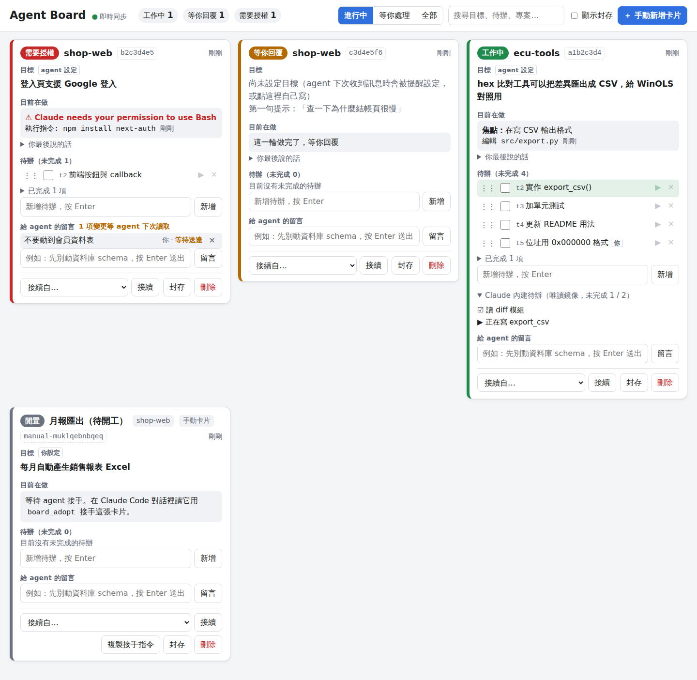

# Agent Board

同時開好幾個 Claude Code 對話時，很容易忘記「每個對話是要替我完成什麼」「還剩哪些待辦」「現在誰卡住在等我」。
Agent Board 是一個跑在本機的面板，把每個對話變成一張卡片：

- **目標**：這個對話要替你達成什麼（agent 會被要求自己寫，你也可以直接改）
- **目前在做**：即時顯示 agent 正在執行的指令／編輯的檔案、是否在等你回覆、是否卡在授權詢問
- **待辦**：你和 agent 都能新增、勾選、改字、拖曳排序
- **給 agent 的留言**：你在面板打的話，會在 agent 下一次收到訊息、或工作途中做完一個工具呼叫時送達
- **Claude 內建待辦**：唯讀鏡像 Claude Code 自己的 TodoWrite / TaskCreate 清單

最重要的是**反向**那一半：每次你在 Claude Code 送出訊息，這張卡片的目標與待辦都會自動塞回給 agent，
所以就算對話很長、被 `/compact` 壓縮過，agent 也不會忘記它的目標；你在面板改了待辦，agent 會收到「使用者改了什麼」的通知。



## 運作方式

```
Claude Code 對話 ──hooks──▶ ┐
Claude Code 對話 ──hooks──▶ ├─▶ Agent Board server (127.0.0.1:47821) ◀── 瀏覽器面板（即時同步）
Claude Code 對話 ──MCP────▶ ┘        資料存在 %USERPROFILE%\.agent-board\board.json
```

| 元件 | 做什麼 |
| --- | --- |
| hooks（`src/hook.js`） | Claude Code 每個事件都呼叫它：回報狀態／目前動作，並在 `SessionStart`、`UserPromptSubmit`、`PostToolUse` 把目標、待辦、新留言注入回 agent |
| MCP server（`src/mcp.js`） | 給 agent 用的工具：`board_get`、`board_list`、`board_set_goal`、`board_set_focus`、`board_add_todo`、`board_update_todo`、`board_remove_todo`、`board_send_note`、`board_adopt` |
| server（`src/server.js`） | 唯一寫資料的地方；REST API + Server-Sent Events 推播給面板。hook 發現 server 沒開時會自動在背景啟動它 |
| 面板（`public/`） | 純 HTML/JS，不需要編譯 |

完全不需要安裝任何 npm 套件，只要 Node.js 18 以上。

## 安裝（Windows 11）

1. 確認有 Node.js 18 以上：在 PowerShell 執行 `node --version`。沒有的話到 <https://nodejs.org> 安裝 LTS 版。
2. 下載這個 repo，放在一個之後不會搬動的地方，例如 `C:\tools\agent-board`：
   ```powershell
   git clone https://github.com/chinhung37/claudecodeui C:\tools\agent-board
   cd C:\tools\agent-board
   ```
3. 安裝 hooks 與 MCP：
   ```powershell
   node bin\agent-board.js install
   ```
   這會：
   - 把 hooks 合併進 `%USERPROFILE%\.claude\settings.json`（**先備份原檔**，只加不改你原本的設定，重複執行不會重複加入）
   - 執行 `claude mcp add --scope user agent-board -- node C:/tools/agent-board/src/mcp.js`
   - 在 `permissions.allow` 加入 `mcp__agent-board`，agent 用看板工具時不用每次按允許（不要的話加 `--no-allow`）

   想先看會改什麼：`node bin\agent-board.js install --dry-run`
4. 開面板：
   ```powershell
   node bin\agent-board.js open
   ```
   或直接用瀏覽器打開 <http://127.0.0.1:47821>。
5. **已經開著的 Claude Code 對話要關掉重開**（或 `/resume`）才會載入新的 hooks 與 MCP。新對話一開始就會出現在面板上。

> 如果你把資料夾搬家了，重新執行一次 `install` 即可（舊的 hooks 會自動被換掉）。

## 使用方式

### 在面板上
- **點目標、名稱、待辦文字**就能直接編輯（目標用 Ctrl+Enter 儲存，Esc 取消）
- 待辦前的勾勾＝完成；▶＝標成「進行中」；拖曳 ⋮⋮ 調整優先順序（越上面越優先）
- 上方篩選：「進行中」「等你處理」（等你回覆／需要授權／可能中斷）「全部」
- 卡片左邊的顏色：綠＝工作中、橘＝等你回覆、紅＝需要授權、紅虛線＝超過 10 分鐘沒動靜（可能中斷）、灰＝閒置／已結束
- 分頁標題會顯示「(2) Agent Board」＝有 2 個對話在等你
- 「給 agent 的留言」會標示「等待送達」→「已送達 12:03」

### agent 會看到什麼
每次你送出訊息時，agent 會收到這樣一段（範例）：

```
[Agent Board] 你的 board_id: 0f3c2a9e-5d1b-4c7e-9a8f-2b6d4e1c7a90（面板 http://127.0.0.1:47821）
目標: hex 比對工具可以把差異匯出成 CSV
待辦（未完成 3 / 共 4，越上面越優先）:
  [>] t2 實作 export_csv()
  [ ] t3 加單元測試
  [ ] t4 位址用 0x000000 格式 (使用者)
  [x] t1 定義 CSV 欄位
使用者/其他 agent 給你的新留言（請優先處理）:
  - n1 [使用者] 先不要改 CLI 參數
自上次以來看板被別人改過:
  - 使用者新增待辦 t4「位址用 0x000000 格式」
  - 使用者留言 n1：「先不要改 CLI 參數」
（完成或開始待辦時請用 board_update_todo 更新看板）
```

- 還沒有目標的卡片，agent 會被提醒用 `board_set_goal` 寫下目標、用 `board_add_todo` 列待辦。
- 新對話開始（`SessionStart`）或 `/compact` 壓縮之後，會收到完整版，另外附上其他進行中的 agent 在做什麼，避免重複工作。
- agent 正在工作時你改了面板，它會在**下一個工具呼叫結束時**收到通知（只送一次）。

### 常見情境
- **`/clear` 之後**：Claude Code 會給新的 session id，所以會出現一張新卡片。新對話會被告知「同專案還有哪些未完成的卡片」，你可以叫 agent 用 `board_adopt` 接過來，或在面板卡片底部的「接續自…」選擇舊卡片。
- **先規劃、再開工**：按「＋ 手動新增卡片」寫好目標，之後按卡片上的「複製接手指令」，貼到新的 Claude Code 對話裡，agent 就會接手這張卡片。
- **agent 之間交接**：agent A 可以用 `board_send_note` 留言給 agent B，或用 `target_board_id` 幫 B 加待辦；B 會在下次 hook 時收到。
- **在終端機看總覽**：`node bin\agent-board.js status`

## 指令

```
node bin\agent-board.js start [--open]   前景啟動 server（平常不需要，hook 會自動在背景啟動）
node bin\agent-board.js open             開面板
node bin\agent-board.js status           終端機列出所有卡片
node bin\agent-board.js stop             關閉背景 server
node bin\agent-board.js install [--minimal] [--no-mcp] [--no-allow] [--settings <檔案>] [--dry-run]
node bin\agent-board.js uninstall [--settings <檔案>] [--no-mcp]
```

- `--minimal`：不裝 `PreToolUse` hook。每次工具呼叫少跑一次 node，但「目前在做」只會在工具結束後才更新。
- `--settings .claude\settings.json`：只裝在某個專案，而不是全域。

## 設定（環境變數）

| 變數 | 預設 | 說明 |
| --- | --- | --- |
| `AGENT_BOARD_PORT` | `47821` | server 連接埠 |
| `AGENT_BOARD_HOME` | `%USERPROFILE%\.agent-board` | 資料與 log 資料夾 |
| `AGENT_BOARD_INJECT` | `always` | `always`＝每次送訊息都注入目標與待辦；`changes`＝只有看板被別人改過才注入；`off`＝完全不注入（只當監看面板用） |
| `AGENT_BOARD_AUTOSTART` | `1` | 設成 `0` 時 hook 不會自動啟動 server |
| `AGENT_BOARD_DEBUG` | — | 設成 `1` 時 hook 的錯誤會寫到 `hook-error.log` |

改變數後要重新啟動 server（`stop` 再讓 hook 自動啟動，或 `start`）。

## 驗證狀態

以下在 Claude Code **2.1.283（Linux）** 用真的 `claude -p` 對話實測過：

| 項目 | 結果 |
| --- | --- |
| `SessionStart` / `UserPromptSubmit` 注入的 board_id 與目標，agent 看得到並能正確用 MCP 工具更新自己的卡片 | ✅ 通過 |
| agent 執行 `sleep 10` 時從面板留言，`PostToolUse` 注入後 agent 逐字回報該留言 | ✅ 通過 |
| `permissions.allow` 寫 `mcp__agent-board` 可放行該 server 的所有工具（對照組：不寫時被拒絕） | ✅ 通過 |
| hook 發現 server 沒開時自動在背景啟動（約 0.25 秒） | ✅ 通過 |
| 面板：新增／勾選／編輯、即時同步、打字中不被即時更新打斷、手機寬度與深色模式 | ✅ Playwright 測過 |

**未驗證**：

- **Windows 11 實機**：程式有針對 Windows 處理（路徑一律轉成 `/`、背景 server 用 `windowsHide`、rename 失敗時退回直接寫檔），但沒有在 Windows 上實際跑過。
- `TaskCreate` / `TaskUpdate`（新版 Claude Code 取代 TodoWrite 的工具）的回應格式官方文件沒寫清楚，鏡像是盡力而為；抓不到 task id 時用流水號對應。
- `Notification` 事件的 `notification_type` 各版本是否一致；判斷不到時用訊息文字裡有沒有 “permission” 來判斷「需要授權」。

## 安全性

- server 只綁 `127.0.0.1`，並檢查 `Host` header（防 DNS rebinding）
- 所有寫入請求都要帶 `X-Agent-Board: 1` header，其他網站無法從瀏覽器跨站改你的看板
- 資料只存在本機的 JSON 檔，不會送到任何外部服務

## 解除安裝

```powershell
node bin\agent-board.js stop
node bin\agent-board.js uninstall
```
資料檔在 `%USERPROFILE%\.agent-board\`，要的話自己刪掉。

## 開發

```powershell
npm test      # node 內建測試框架，不需要安裝任何套件
```
